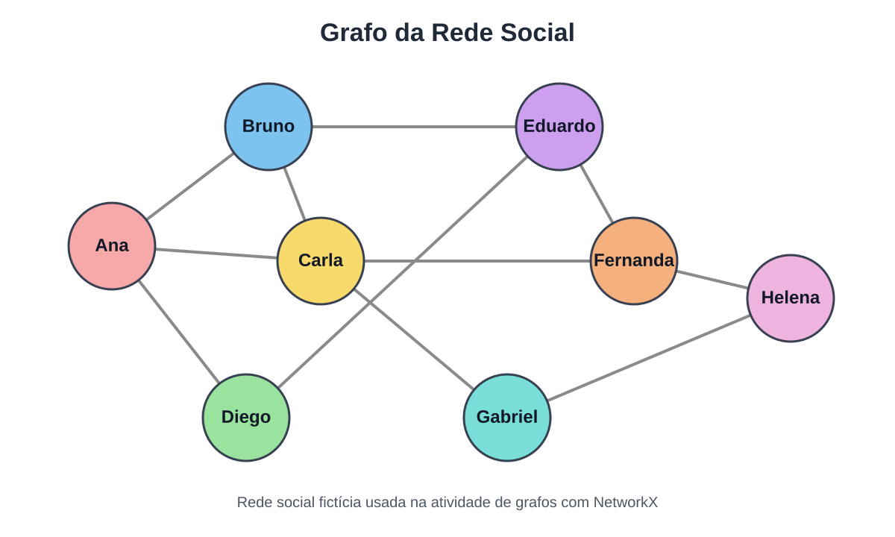

# Grafos com NetworkX — Rede Social

Atividade prática de **Estrutura de Dados II** para aplicar conceitos de grafos em uma rede social fictícia.

## Objetivos

O exercício utiliza `NetworkX` para:

1. construir um grafo não direcionado;
2. visualizar a rede social;
3. calcular o grau de cada vértice;
4. identificar o usuário com mais conexões;
5. encontrar o caminho mais curto entre Ana e Helena;
6. remover a aresta Carla–Fernanda e verificar a conectividade;
7. sugerir novas amizades com base em amigos em comum.


## Visualização do grafo



## Conceitos

- **Vértice:** representa um usuário.
- **Aresta:** representa uma amizade.
- **Grau:** quantidade de conexões de um vértice.
- **Caminho:** sequência de vértices conectados.
- **Conectividade:** existência de caminho entre dois vértices.

Na rede inicial, **Carla** é o vértice de maior grau, com 4 conexões.

## Dependências

```bash
pip install networkx matplotlib
```

## Execução

```bash
python3 rede_social.py
```

O script também gera duas visualizações: a rede original e a rede após a remoção da amizade entre Carla e Fernanda.
